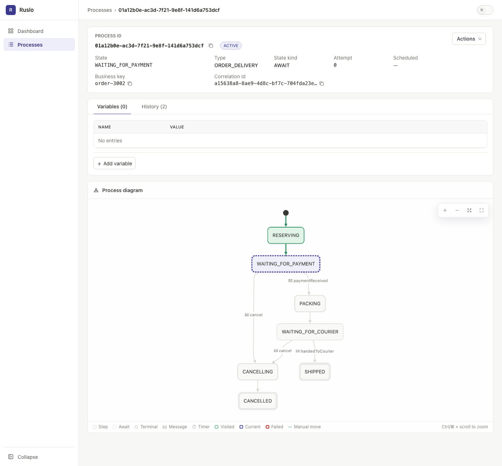

# Ruslo

[](https://github.com/neherim/ruslo/actions/workflows/ci.yml)
[](https://central.sonatype.com/namespace/io.github.neherim)
[](LICENSE)


English | [Русский](README.ru.md)

An embedded engine for long-running business processes in Java and Spring Boot. You describe a process as a state
machine in a Java DSL, and the engine runs it right inside your application, keeping its state in the database you
already have. No separate cluster, broker or BPMN.

Typical uses:

- an order waits for payment, then for delivery, and is cancelled if a deadline passes;
- customer onboarding waits days for documents and sends reminders;
- a call to an external API is retried with delays, and the process falls back to a compensating state if the API
  keeps failing.



## Features

- **One database transaction with your data.** A step changes application data atomically with the process transition.
- **No infrastructure.** The engine is a library that uses your application's database: PostgreSQL in production,
  H2 for tests and local runs. There is no server, broker or cluster to deploy.
- **Typed DSL.** Message payloads and handler forms are checked by the compiler.
- **Deterministic tests.** The engine's test emulator runs steps and moves time forward without `sleep`.

Like other durable process engines, Ruslo commits every transition, so a process survives restarts and node
failures; waits for a message or a timer (minutes, days, weeks) without holding a thread; and shares processes
between several application instances through the common database.

## Example

An order waits for payment. If the payment does not arrive within 2 hours, the order is cancelled.

```java
// Declare the process states
public enum OrderState implements ProcessState {
    CREATED, WAITING_FOR_PAYMENT, PAID, CANCELLED
}

// Implement a process step handler
@Component
@RequiredArgsConstructor
public class ReserveStockStep implements ProcessStep {
    private final OrderRepository orders;

    @Override
    public void execute(ProcessContext context) {
        long orderId = context.getVariable(OrderProcess.ORDER_ID);
        // The whole execute method runs in the same database transaction that records the move to the next state
        orders.reserveStock(orderId);
    }
}

// Describe the process itself and the transitions between states
@Component
public class OrderProcess extends SpringProcessDefinition {
    public static final ProcessType TYPE = ProcessType.of("ORDER");
    public static final VariableType<Long> ORDER_ID = VariableType.of("orderId");
    public static final MessageType<PaymentConfirmed> PAYMENT_CONFIRMED =
            MessageType.of("paymentConfirmed", PaymentConfirmed.class);

    @Override
    public ProcessSpec define(ProcessSpecBuilder builder) {
        return builder.type(TYPE)
                .initialState(CREATED)
                // bean(...) takes the handler from the Spring context
                .step(CREATED, bean(ReserveStockStep.class), WAITING_FOR_PAYMENT)
                .await(WAITING_FOR_PAYMENT, await -> await
                        .message(PAYMENT_CONFIRMED, bean(PaymentHandler.class), PAID)
                        .after(Duration.ofHours(2), CANCELLED))
                .terminal(PAID)
                .terminal(CANCELLED)
                .build();
    }
}
```

A process is started and receives messages through `ProcessEngine`:

```java
// start a process
UUID processId = processEngine.newProcess(OrderProcess.TYPE)
        .businessKey(order.number())
        .variable(OrderProcess.ORDER_ID, order.id())
        .start();

// later, e.g. in the payment callback
processEngine.sendMessage(processId, OrderProcess.PAYMENT_CONFIRMED, new PaymentConfirmed(amount));
```

`start` and `sendMessage` join the caller's transaction; the step or handler runs after commit. The business key
lets you find the process by order number in search and in the Admin UI.

The full example with a test is in the [quickstart](docs/quickstart.md).

## Installation

```xml
<dependency>
    <groupId>io.github.neherim</groupId>
    <artifactId>ruslo-spring-boot-starter</artifactId>
    <version>0.1.0</version>
</dependency>
```

Requirements: Java 21, Spring Boot 4, PostgreSQL (H2 works for tests and local runs).
The engine creates its database tables on startup.

Additional modules:

| Artifact | Purpose |
|---|---|
| `ruslo-core` | [Engine without Spring](docs/configuration.md#engine-without-spring) |
| `ruslo-admin-ui` | Web UI: process search, diagram, manual intervention |
| `ruslo-spring-boot-starter-test` | `@ProcessEngineTest` and the emulator for tests (scope `test`) |

## Performance

With empty handlers on one PostgreSQL, one engine executes about 4 800 steps/s with the transactional worker.
Every transition is a database commit, so throughput is bounded by the database: two or four instances on the same
database add 14–28%. Conditions and raw data:
[performance report](docs/performance/2026-10-11-1-d5c2eb6/performance-report.md).

## When not to use it

- Your production database is not PostgreSQL: the engine currently supports only PostgreSQL and H2.
- Your application runs on Spring Boot 3: the starter requires Spring Boot 4.
- You need a stable API now: in 0.x, incompatible changes are possible in minor versions.
- You need a stateless task queue. Kafka, RabbitMQ or db-scheduler is a better fit.
- You need process versioning: running processes use the current definition; its version is not stored.
- You need executable BPMN or a visual process editor. Camunda or Flowable is a better fit.
- You need orchestration across services in different languages with a dedicated cluster. Temporal is a better fit.

## Documentation

Start here:

1. [Quickstart](docs/quickstart.md): a working order process, from dependencies to a test.
2. [Process model](docs/concepts.md): steps, awaits, branching, timers, variables, definition evolution.

Reference:

| Section | Contents |
|---|---|
| [Guarantees](docs/guarantees.md) | What survives a failure, message delivery, timer accuracy |
| [Error handling](docs/error-handling.md) | Delayed retries, give-up state |
| [Workers](docs/workers.md) | Separate pools for steps with external I/O |
| [Execution](docs/execution.md) | Exact rules of event selection and transaction boundaries |
| [Spring Boot](docs/spring.md) | Starter, `SpringProcessDefinition`, application transactions |
| [Configuration](docs/configuration.md) | Engine without Spring; all settings and `ruslo.*` properties |
| [Testing](docs/testing.md) | `@ProcessEngineTest`, emulator, timers, step unit tests |
| [Operations](docs/operations.md) | Production checklist, process search, cleanup of completed processes |
| [Admin UI](docs/admin-ui.md) | Viewing and managing processes |
| [Metrics](docs/metrics.md) | Micrometer, list of metrics |

Ready-to-run examples: [`ruslo-examples`](ruslo-examples/README.md).

## AI coding agents

[`skills/ruslo/SKILL.md`](skills/ruslo/SKILL.md) is a skill for coding agents: the process model, handler types,
error handling, testing, configuration, common patterns and mistakes on one page. It does not need network access;
it follows the latest version of the library. In Claude Code, put it in your project:

```bash
mkdir -p .claude/skills/ruslo
curl -o .claude/skills/ruslo/SKILL.md https://raw.githubusercontent.com/neherim/ruslo/main/skills/ruslo/SKILL.md
```

For other agents, reference the file from `AGENTS.md` or your agent's rules file.

## Status

Version 0.x: incompatible changes to the public API (`io.github.neherim.ruslo.core.api.*` and `core.spi.*`)
are possible in minor versions. Other packages are internal.

## License

[Apache License 2.0](LICENSE). How to build the project and run the tests is described in [CONTRIBUTING.md](CONTRIBUTING.md).
