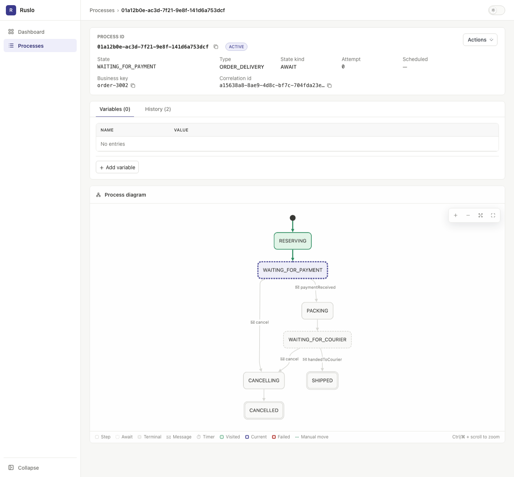

# Ruslo

Встраиваемый движок долгоживущих бизнес-процессов для Java. Вы описываете процесс как конечный
автомат на Java DSL, а движок выполняет его прямо внутри вашего приложения и хранит состояние в реляционной БД.
Без отдельного кластера, брокера и BPMN.

Типичные задачи:

- заказ ждёт оплату, потом доставку и отменяется, если срок истёк;
- онбординг клиента днями ждёт документы и отправляет напоминания;
- вызов внешнего API повторяется с задержками, а если API продолжает падать, процесс уходит в компенсирующее
  состояние.



## Установка

```xml
<dependency>
    <groupId>io.github.neherim</groupId>
    <artifactId>ruslo-spring-boot-starter</artifactId>
    <version>0.1.0</version>
</dependency>
```

Требования: Java 21, Spring Boot 4, PostgreSQL (H2 подходит для тестов и локального запуска).

## С чего начать

1. [Быстрый старт](quickstart.md): рабочий процесс заказа от зависимостей до теста.
2. [Процессы](processes.md): описание, переходы, запуск, переменные, поиск, эволюция описания.
3. [Шаги](steps.md) и [ожидания](awaits.md): код процесса, сообщения и таймеры.

Разделы справочника — в навигации. Возможности, ограничения и замеры производительности описаны в
[README](https://github.com/neherim/ruslo/blob/main/README.ru.md); готовые примеры — в
[`ruslo-examples`](https://github.com/neherim/ruslo/tree/main/ruslo-examples).
